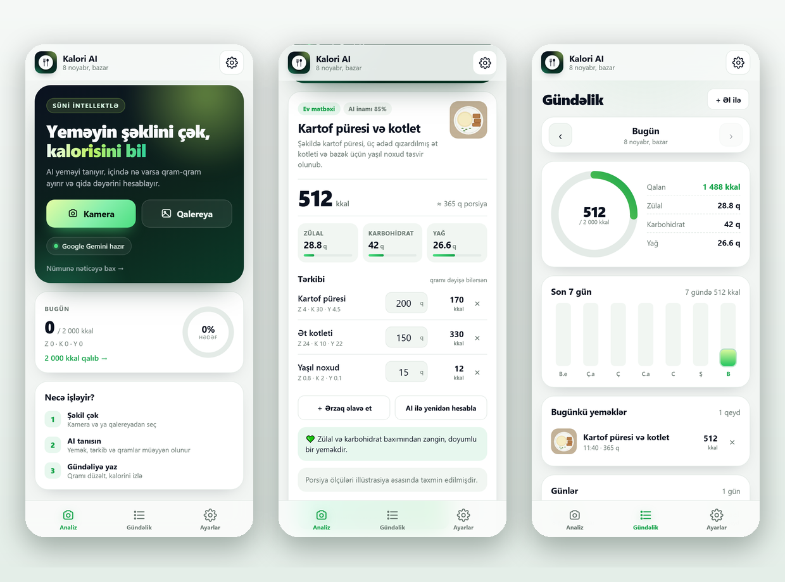

# Kalori AI

iPhone üçün **PWA**: yeməyin şəklini çəkirsiniz, süni intellekt yeməyi tanıyır, içindəkiləri qram-qram ayırır və kalori / zülal / karbohidrat / yağ dəyərini hesablayır. Nəticəni əl ilə düzəldə, ərzaq əlavə edə və AI-yə yenidən hesablada bilirsiniz. Hər gün üçün ayrıca gündəlik tutulur.

Backend yoxdur — tətbiq statik fayllardan ibarətdir və birbaşa Google Gemini-yə müraciət edir. API açarı **Ayarlarda bir dəfə** daxil edilir və yalnız cihazda saxlanılır (istəsəniz `config.js`-ə də yazmaq olar).



## Nə edir

- **Şəkildən analiz** — kamera və ya qalereya. Şəkil avtomatik 1200px-ə kiçilir.
- **AI cavabı** — yeməyin adı, növü, təsviri, tərkibi (hər məhsulun qramı, kalorisi, zülalı, karbohidratı, yağı), ümumi göstəricilər, AI inam faizi.
- **Tərkibi əl ilə düzəlt** — hər məhsulun qramını dəyiş, lazımsızunu sil. `＋ Ərzaq əlavə et` ilə 100-dən çox məhsulluq **axtarışlı siyahı**dan seç.
- **Siyahıda olmayan ərzaq** — adını və qramını yaz; kalorini bilmirsənsə **AI 100 q üçün kalori və makroları təxmin edir**.
- **AI ilə yenidən hesabla** — tərkib dəyişdikdən sonra düyməni bas; AI bütün qramları nəzərə alıb kalori və makroları yenidən hesablayır.
- **Gündəlik** — gün seçimi: `‹ ›` düymələri, son 7 günün qrafiki (sütuna toxun) və “Günlər” siyahısı. Seçilmiş günün kalorisi, makroları və yeməkləri görünür; yeməyə toxunanda tərkibi açılır.
- **Makro normaları** — gündəlik kalori hədəfinə görə zülal / karbohidrat / yağ norması hesablanır; qəbul, norma və qalan (və ya artıq) miqdar göstərilir.
- **Sağlamlıq balı** — hər yeməyə **1–10** bal: məsələn tort 3/10, toyuq plovu 7/10, tərəvəz salatı 9–10.
- **Yeməyi redaktə et** — gündəlikdəki hər yeməyin yanındaki **qələm** ikonu ilə adı, qramları və tərkibi dəyiş, ərzaq əlavə et, AI ilə yenidən hesabla və **Yadda saxla**.
- **Tema** — Avtomatik (telefonun rejiminə görə), Açıq, Tünd.
- **Ayarlar** — gündəlik hədəf, AI modeli, mövcud modellərin siyahısı.
- **Offline app shell** — service worker interfeysi keşləyir; internet yalnız AI sorğusu üçün lazımdır.
- **iPhone detalları** — `standalone` rejimi, safe-area, apple-touch-icon, “Ekrana əlavə et” ipucu.

## Sürətli başlanğıc (kompüterdə)

1. `baslat.cmd` faylını iki dəfə açın (və ya bu qovluqda `python -m http.server 8123`).
2. Brauzerdə `http://localhost:8123` açın.

`localhost` təhlükəsiz kontekst sayıldığı üçün kamera və service worker burada işləyir. `index.html`-i birbaşa (`file://`) açmayın — PWA işləməyəcək.

## iPhone-a quraşdırma

PWA-nın telefonda quraşdırılması və kamerasının işləməsi üçün **HTTPS** lazımdır. Ən asan yol:

1. [Netlify Drop](https://app.netlify.com/drop) səhifəsinə **`kalori-ai.zip`** faylını (və ya `kalori-ai` qovluğunu) sürüşdürün. Dərhal `https://...netlify.app` linki alırsınız (hesab lazım deyil).
   Alternativ: GitHub Pages, Vercel, Cloudflare Pages — hamısı pulsuzdur.
2. Linki **iPhone Safari**-də açın.
3. **Paylaş → “Ekrana əlavə et”**.
4. Tətbiqi açın → **Ayarlar → AI açarı** → açarı yapışdırın → **Yadda saxla**. Açar yalnız həmin cihazda qalır.

**GitHub Pages ilə:** repo yaradın → zip-i kompüterdə açın → içindəki faylları repo **kökünə** yükləyin (`icons/` qovluğu da daxil) → **Settings → Pages → Deploy from a branch → `main` / `(root)`**. Link: `https://istifadəçi.github.io/repo/`.

> Faylları dəyişdikdən sonra yenidən yükləyin. Service worker `v1.5.1` keşi avtomatik yeniləyir; ilk açılışda səhifəni iki dəfə yeniləmək lazım ola bilər.

## Yeniləmə

1. Yeni `kalori-ai.zip`-i deploy et — **bütün faylları** əvəz et (xüsusən `index.html`, `app.js`, `styles.css`, `sw.js`).
2. Tətbiqi aç → **Ayarlar → Versiya**. Orada **1.5.1** yazmalıdır. Əgər köhnə rəqəm görünürsə, fayllar hələ yenilənməyib.
3. **Ayarlar → “Yeniləməni yoxla”** düyməsini bas və təsdiq et. Bu, service worker keşini təmizləyib proqramı yenidən açır — **qeydlər silinmir**.
4. Alternativ: səhifəni iki dəfə yenilə və ya tətbiqi bağlayıb yenidən aç.

> Ekrandaki tətbiq ikonunu silmə — iOS onunla birlikte qeydləri də silir. Yeniləmək üçün yuxarıdaki üsulları istifadə et.

## AI açarı

Açarı **Ayarlar → AI açarı** sahəsinə bir dəfə daxil edirsiniz; `localStorage`-da yalnız həmin cihazda saxlanılır. Repository-də açar olmadığı üçün GitHub-a public yükləmək təhlükəsizdir.

- **401 / “API açarı etibarsızdır”** görsəniz: açar ləğv olunub və ya yanlışdır. [aistudio.google.com/app/apikey](https://aistudio.google.com/app/apikey) → **Create API key** → yeni açarı Ayarlarda yapışdırın.
- Açarı koda yazmaq istəsəniz: `config.js` → `geminiApiKey: 'AQ....'`. Bu halda Ayarlarda açar sahəsi görünməz, amma **public repoda açar tez ləğv olunur** — tövsiyə edilmir.
- Standart model: **`gemini-3.6-flash`** (~5–10 saniyə). Ayarlarda **“Mövcud modelləri gətir”** düyməsi açarınıza uyğun modelləri siyahıya salır.
- Köhnə `gemini-2.5-flash` yeni istifadəçilər üçün bağlıdır (404). Tətbiq avtomatik `gemini-3.6-flash → gemini-3.7-flash → gemini-3.5-flash-lite` sırası ilə yoxlayır.

> **Vacib:** açarı public GitHub reposuna və ya `config.js`-ə yazmayın. Açarı brauzerə göndərmədən saxlamaq üçün backend proxy (Cloudflare Worker / Netlify Function) lazımdır — bu, növbəti addımdır.

## Tema

Ayarlar → **Görünüş**:

- **Avtomatik** (default) — telefon ağ rejimdədirsə ağ, qara rejimdədirsə qara.
- **Açıq** / **Tünd** — əl ilə seçim. Seçim dərhal tətbiq olunur və yadda saxlanılır.

## Gündəlik: günə baxmaq

1. **Gündəlik** bölməsinə keçin.
2. `‹` / `›` ilə günü dəyişin, 7 günlük qrafikdə sütuna toxunun və ya aşağıdakı **Günlər** siyahısından gün seçin.
3. Həmin günün kalorisi, zülal/karbohidrat/yağ göstəriciləri və yeməkləri görünür.
4. Yeməyə toxunanda tərkibi (ad, qram, kalori) və sağlamlıq balı açılır.
5. “Bugünə qayıt” ilə geri dönün.

## Makro normaları

Gündəlik kalori hədəfi əsasında balanslı bölgü hesablanır: **25% zülal, 45% karbohidrat, 30% yağ**.

- 2000 kkal → **125 q zülal · 225 q karbohidrat · 67 q yağ**
- 1800 kkal → **113 q zülal · 203 q karbohidrat · 60 q yağ**

**Gündəlik → Makrolar** bölməsində hər biri üçün `qəbul / norma` və “X q qalıb” və ya “X q artıq” yazılır; sütun yaşıl, artıq olduqda qırmızı olur. Ayarlarda hədəfi yazanda norma dərhal göstərilir.

## Sağlamlıq balı (1–10)

Hər yemək və hər gündəlik qeydi **1–10** balla qiymətləndirilir. Bal yeməyin növünə və qida dəyərinə görə hesablanır:

| Bal | Qiymət | Nümunə |
|---|---|---|
| 9–10 | Əla | tərəvəz salatı, meyvə, toyuq döşü, qoz |
| 7–8 | Yaxşı | toyuq plovu, şorba, qızarmış ət, yumurta |
| 5–6 | Orta | çörək, düyü, kartof, zeytun yağı |
| 3–4 | Zəif | tort, pizza, hamburger, kartof fri |
| 1–2 | Çox zəif | şəkərli içki, sosis, şokolad |

Hesablamada kateqoriya (salat/meyvə +, qənnadı/fast food −), zülal payı, yağ payı və kalori sıxlığı nəzərə alınır. Bal **təxminidir**, tibbi göstərici deyil.

## Yeməyi redaktə etmək

1. **Gündəlik**-də istədiyin günə keç.
2. Yeməyin sağındaki **qələm (✎)** ikonuna toxun — redaktə ekranı açılır.
3. Adı dəyiş, qramları düzəlt, **＋ Ərzaq əlavə et** ilə tərkib əlavə et və ya **×** ilə sil, istəsən **AI ilə yenidən hesabla**.
4. **Yadda saxla** — dəyişikliklər həmin günün qeydinə yazılır və gündəlik yenilənir.
5. **Ləğv et** — heç nə dəyişmir. Keçmiş günü redaktə etsən, yadda saxladıqdan sonra yenə həmin günə qayıdırsan.

## Siyahıda olmayan ərzaq əlavə etmək

1. Nəticə ekranında (və ya redaktədə) **＋ Ərzaq əlavə et** → **“Siyahıda yoxdur — özün yaz”**.
2. Adı və **qramı** yaz.
3. **Kalori** sütununu boş buraxsan, AI 100 q üçün kalori və makroları təxmin edir; proqram qramına uyğun hesablayır.
4. Kalorini özün bilirsənsə, 100 q üçün dəyəri yaz — AI çağırışı olmadan əlavə olunur.
5. **Əlavə et** — ərzaq qramı ilə birlikdə tərkibə düşür.

> AI təxmini üçün Ayarlarda açar olmalıdır. Açar yoxdursa, kalori sütununu əl ilə doldur.

## Ehtiyat nüsxə: qeydləri itirməmək

iOS-da ekrandaki tətbiq ikonunu silsən, həmin PWA-nın yaddaşı (qeydlər) silinir. Ona görə:

- **Yeniləmək üçün ikonu silmə** — tətbiqi aç, səhifəni yenilə (aşağı çək) və ya bağlayıb yenidən aç. Eyni ünvan olduğu müddətdə qeydlər qalır.
- Telefonu dəyişəndə, tətbiqi yenidən quraşdırarkən və ya brauzer məlumatlarını təmizləyəndə əvvəlcə **ehtiyat nüsxəsini** götür.

**Fayl ilə (tövsiyə olunur):** Ayarlar → **Ehtiyat nüsxə** → **Fayl kimi saxla**. `kalori-ai-backup-YYYY-MM-DD.json` faylı Files-ə yüklənir. Bərpa: yeni qurulumda **Fayldan bərpa et** → faylı seç. Bu üsul uzun kodun kopyalanması problemini aradan qaldırır.

**Kod ilə:** **Kodu kopyala** → `KALORI1:...` kopyalanır. Bərpa: **Bərpa kodu** sahəsinə yapışdır → **Bərpa et**. Kodun əvvəlində/sonunda boşluq və ya dırnaq olsa da qəbul olunur. Əgər “Kod natamamdır” yazsa, kodun bir hissəsi kopyalanmayıb — yenidən kopyala və ya fayl üsulunu istifadə et.

Qeydlər, günlər, hədəf və tema geri gəlir. Mövcud qeydlər silinmir — eyni ID-li qeydlər yenilənir.

> Koda **şəkillər** və **API açarı** daxil deyil. Bərpadan sonra açarı yenidən daxil etməlisən. Kod mətnində qida gündəliyin var — lazımsız yerdə paylaşma.

## Təhlükəsizlik və məxfilik

- Açar Ayarlarda daxil edilibsə, yalnız həmin cihazın `localStorage`-unda saxlanılır; repo-da və ya serverdə deyil.
- `config.js`-ə açar yazılsa, o, saytın mənbə kodunda görünür — public repo üçün tövsiyə edilmir.
- Qeydlər, hədəf və tema yalnız cihazda (`localStorage`) qalır.
- Şəkil yalnız Google Gemini-yə göndərilir.
- Telefonu başqasına verirsinizsə: Ayarlar → “Bütün məlumatları sil”.

## Fayl strukturu

```
kalori-ai/
├── index.html            # bütün ekranlar
├── styles.css            # dizayn (işıq + qaranlıq + tema dəyişənləri)
├── app.js                # məntiq: kamera, AI, ərzaq, gündəlik, ayarlar
├── config.js             # AI konfiqurasiyası (açar opsional)
├── foods.js              # 100+ ərzağın 100 q üçün qida dəyərləri
├── sw.js                 # service worker (offline)
├── manifest.webmanifest  # PWA manifest
├── icons/                # 192, 512, maskable, apple-touch
├── tools/                # generatorlar və test skriptləri
├── baslat.cmd            # lokal server (Windows)
├── preview.png           # ekran görüntüsü
└── shots/                # test ekran görüntüləri
```

Deploy üçün `index.html`, `styles.css`, `app.js`, `config.js`, `foods.js`, `sw.js`, `manifest.webmanifest` və `icons/` lazımdır.

## Yoxlama (developer)

Testlər Chrome/Edge-i `--remote-debugging-port=9344` ilə başladıb CDP üzərindən işləyir:

```bash
node tools/shot.mjs          # iPhone ölçüsündə ekran görüntüləri + tüstü testləri
node tools/ui-test.mjs       # tema, ərzaq axtarışı/əlavə/silmə, AI recalc, gün seçimi
node tools/edit-test.mjs     # gündəlikdə yemək redaktəsi (ad, qram, tərkib, yadda saxla)
node tools/backup-test.mjs   # xüsusi ərzaq (əl ilə + AI) və ehtiyat kodunun bərpası
node tools/macro-test.mjs    # makro normaları və sağlamlıq balı
node tools/version-test.mjs  # versiya göstəricisi və “Yeniləməni yoxla”
node tools/api-test.mjs      # Gemini sorğularını mock cavablarla yoxlayır
node tools/offline-test.mjs  # service worker və oflayn rejim
```

Real açar ilə tam axın (kvota istifadə edir):

```powershell
$env:GKEY = "AQ...."; $env:CDP_PORT = "9344"; node tools/live-test.mjs
```

## Məhdudiyyətlər

- AI **təxmin** edir: porsiya ölçüsü və yağ miqdarı həmişə dəqiq deyil. Qramları düzəltmək və AI ilə yenidən hesablamaq nəticəni dəqiqləşdirir.
- Ərzaq bazasındakı dəyərlər təxminidir (100 q üçün).
- Şəkil keyfiyyəti aşağıdırsa və ya yemək qarışıqdırsa, AI inam faizi aşağı düşür.
- Bu, tibbi məsləhət deyil.
- HEIC şəkilləri bəzi brauzerlərdə açılmaya bilər; Safari adətən avtomatik JPEG-ə çevirir.

## Növbəti addımlar (istəsəniz)

- Backend proxy — açarı serverdə gizlətmək və limitləri idarə etmək
- Barkod skaneri və məhsul bazası
- Apple Health / Google Fit inteqrasiyası
- Hesab və bulud sinxronizasiyası
